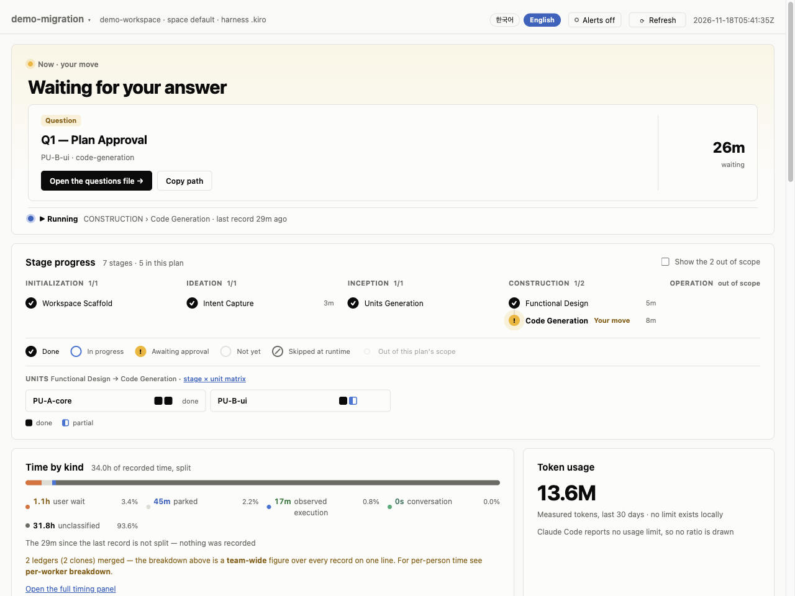
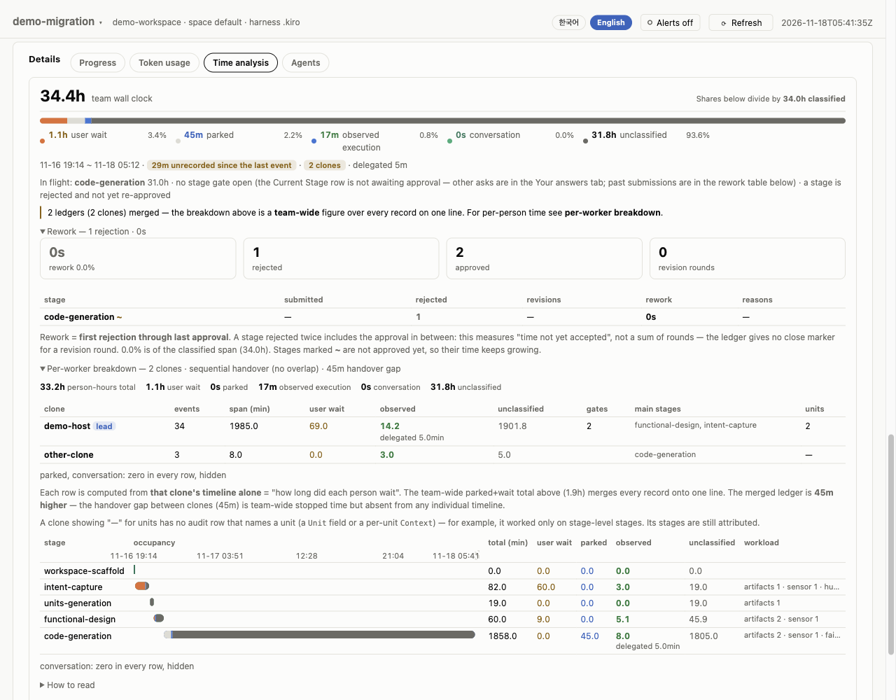

# aidlc-dashboard

This sample shows how to observe an [AI-DLC](https://github.com/awslabs/aidlc-workflows) run from
the record it leaves in a workspace's `aidlc/` folder, as one local web page: what is waiting on you,
where the run is, where the time went, and what the run spent — Kiro credit through `kiro-cli`'s ACP
`/usage` command (optional), or Claude Code tokens from the local transcripts. It is **read-only**:
it never writes into the `aidlc/` record. The server binds `127.0.0.1` only. The one file it writes is
the credit history, `data/usage.db` (with its SQLite WAL sidecars): beside the executable for a built
executable, in `data/` under the current directory for a source run (so start a source run from the
clone, not from the workspace), or wherever `AIDLC_DASHBOARD_DATA_DIR` points. When the Kiro credit
panel collects, `kiro-cli acp` itself records its session under `~/.kiro/sessions/cli/`.

The page is server-rendered HTML with no build step, and it reads the record the way the AI-DLC
engine's own readers do (stage state, the audit ledger, questions files, unit receipts), so a gate,
an open decision or an unanswered question shows when the engine would wait on it. The page is in
Korean and English (`?lang=ko|en`, or `--lang` for the default).



[aws-samples/sample-aidlc-pulse](https://github.com/aws-samples/sample-aidlc-pulse) is a separate
sample that also reads the AI-DLC record (Python, standard library only). This one is a TypeScript
server on Bun, and adds the usage panel described above.

> **Note:** This is sample code, for non-production usage. You should work with your security and
> legal teams to meet your organizational security, regulatory and compliance requirements before
> deployment.

## Prerequisites

- [Bun](https://bun.sh) — the version is under [Run from source](#run-from-source).
- An AI-DLC workspace: a folder holding `aidlc/spaces/` (where AI-DLC keeps its records).
- Optional: [Kiro CLI](https://kiro.dev) (`kiro-cli` on PATH) for the credit panel, or Claude Code
  transcripts under `~/.claude/projects/` for the token panel.

## Run from source

Bun 1.4.0 or later is required.

```bash
git clone <this repository's clone URL> aidlc-dashboard
cd aidlc-dashboard
bun install --frozen-lockfile
bun run src/server.ts                        # start on the folder picker
bun run src/server.ts --root ~/path/to/ws    # start on that workspace
# → http://127.0.0.1:4321 (a source run does not open the browser — pass --open for that)
```

`Ctrl+C` stops it.

## Install an executable

No releases are published, so the installer builds the executable from your clone. On macOS and
Linux, with Bun installed (and `zip`/`unzip`, which most Linux distributions package separately):

```bash
git clone <this repository's clone URL> aidlc-dashboard
cd aidlc-dashboard
sh install.sh
```

The installer checks Bun's version, builds one executable for this machine (Bun is inside it, so the
installed dashboard does not need Bun to run), installs it to `~/.aidlc-dashboard` with an
`aidlc-dashboard` launcher in `~/.local/bin` (if that folder is not on PATH, the installer prints the
full path), and starts it: the browser opens on the folder picker. It never installs Bun and
downloads nothing; without Bun, or with one that is too old, it says so and stops. Afterwards:

```bash
aidlc-dashboard                       # folder picker
aidlc-dashboard ~/path/to/workspace   # straight to that workspace
```

To update, `git pull` and run `sh install.sh` again: the install is replaced in place and the
collected credit history (`data/usage.db`) is kept.

To build an archive yourself — for another machine, or for one of the other targets
(`darwin-arm64` for Apple Silicon, `darwin-x64` for an Intel Mac, `linux-x64`, `linux-arm64`) — use
`bun run package` and hand the zip to the installer, which then needs no Bun:

```bash
bun run package dist --only linux-x64
AIDLC_ARCHIVE=dist/aidlc-dashboard-<version>-linux-x64.zip sh install.sh
```

### Windows

In PowerShell, inside the clone:

```powershell
bun install --frozen-lockfile
bun run package dist --only windows-x64
$env:AIDLC_ARCHIVE = "dist\aidlc-dashboard-<version>-windows-x64.zip"
Get-Content -Raw .\install.ps1 | iex
```

`Get-Content -Raw … | iex` runs the script from memory, so an execution policy that blocks unsigned
`.ps1` files does not stop it. The executable goes to
`%LOCALAPPDATA%\Programs\aidlc-dashboard\aidlc-dashboard.exe`, and that folder is **added to your
user PATH** (no administrator rights needed; the installer says so first), so `aidlc-dashboard` runs
in that window and in new terminals. Windows on ARM runs the x64 executable under emulation.

An install in the older location (`%USERPROFILE%\.aidlc-dashboard` plus
`%USERPROFILE%\.local\bin\aidlc-dashboard.cmd`) is moved over: the credit history (`data\`) comes
along, the old folder and launcher are removed, and `.local\bin` is removed from the folder and the
user PATH only when it is left empty (other tools use it too). **Close every running
`aidlc-dashboard` before installing** — the installer stops and changes nothing while one runs.

The executable is not signed. Double-clicking it from a zip a browser downloaded makes SmartScreen
show "Windows protected your PC" with an unknown publisher (run it from **More info**); installing
with `install.ps1` and starting `aidlc-dashboard` from a terminal does not.

### Installer settings

Set with environment variables (`$env:AIDLC_DIR = …` in PowerShell).

| Variable | Meaning |
|---|---|
| `AIDLC_ARCHIVE` | The zip to install (a `dist/…zip` built with `bun run package`). Required on Windows; on macOS and Linux it replaces the build `install.sh` runs. The installers download nothing |
| `AIDLC_DIR` | Install location (default `~/.aidlc-dashboard` on macOS and Linux, `%LOCALAPPDATA%\Programs\aidlc-dashboard` on Windows). When set, the Windows move from the older location is skipped |
| `AIDLC_BIN_DIR` | (macOS, Linux) Folder for the launcher (default `~/.local/bin`) |
| `AIDLC_NO_BIN=1` | (macOS, Linux) Do not create the launcher |
| `AIDLC_NO_RUN=1` | (macOS, Linux) Do not start the dashboard after installing |
| `AIDLC_NO_PATH=1` | (Windows) Do not add the install folder to the user PATH |

You can also unzip the archive and run the executable directly (it holds the executable and this
README). The credit history then lives in `data/` beside it.

⚠️ **On Windows, a clone made with Git for Windows' default `core.autocrlf=true` before this
repository pinned its line endings keeps CRLF files after a pull**, and `bun run lint` then fails on
almost every file while `git status` stays clean. Commit or stash your changes, then:

```powershell
git rm -q --cached -r .
git reset --hard
```

`reset --hard` drops uncommitted changes; the ignored `node_modules` and `data/` stay.

## Flags

| Flag | Meaning | Default |
|---|---|---|
| `--root <path>` | Workspace root holding `aidlc/`. **Optional** (without it, the folder picker opens) | — |
| `--port <n>` | HTTP port. Also `AIDLC_DASHBOARD_PORT` | `4321` |
| `--poll <ms>` | Browser refresh interval, `0` to turn it off (manual refresh still works) | `60000` |
| `--interval <ms>` | Credit collection interval. Also `AIDLC_DASHBOARD_INTERVAL_MS` | `300000` |
| `--harness <dir>` | Harness dir to read the stage catalogue from. **Usually not needed** (discovered) | auto |
| `--usage <mode>` | Usage panel: `auto`, `kiro` or `claude`. `auto` follows the harness dir | `auto` |
| `--lang <ko\|en>` | Default page language; a reader's `?lang=`, cookie or browser language overrides it | `en` |
| `--open` / `--no-open` | Open the browser once the server listens | on for the executable, off from source |

A harness dir (`.claude`, `.kiro`, …) is not required, but without it the unit matrix falls back to
an approximation; the page then says so and suggests `--harness`.

A second launch on a port an `aidlc-dashboard` already holds opens the running one instead (and
hands it a different `--root` if you gave one). A port held by another program is named with a hint
to use `--port`.

## Choosing a workspace

Without `--root` you pick the folder in the browser. While running, the **workspace name** in the
header opens the list of found workspaces; choosing one switches to it without a restart. **📁 Change
folder** at the top of that list goes to the picker below.

The picker looks for folders holding `aidlc/spaces/` under your home and common development
locations (`Development`, `Developer`, `Projects`, `Code`, …; on Windows also `USERPROFILE` and the
OneDrive folders). A skill or project folder merely named `aidlc` is not a workspace.

Found workspaces come first: the one on screen as **showing now**, then those with a run, newest state
update first, and those with no run or only archived intents folded at the bottom. A whole card is
one link and shows completion, blank answers, the current stage and when the state file was last
updated. Paths are home-relative and cut in the middle so the distinguishing end stays (the full path
is the tooltip). The box above the list filters by name or path.

**Open another location** below is one path field: it holds the folder on screen as `~/…/`, with a
breadcrumb and the folder's children under it.

- Text after the last `/` filters this folder's list. A path into another folder leaves the list as
  it is and says "Press Enter to go there".
- **Enter** or **Open**: a folder holding `aidlc/spaces/` opens as a dashboard; any other folder is
  listed. A missing path or a file is refused with the reason. Choosing the `aidlc` folder itself
  opens its parent.
- **Tab** completes a single match, **Esc** restores the folder on screen, **↓** moves into the list.
  `~` works.

The root buttons before the field depend on the OS: home, the filesystem root and `/Volumes` on
macOS; home, the root, `/mnt` and `/media` on Linux; home, the available drives and OneDrive on
Windows.

## What the page shows

Top to bottom:

- **Now** — what waits on your answer comes first: its kind (question, confirmation, approval,
  decision, …), title, unit and stage, how long it has waited, **open the questions file** and **copy
  path**. Further items are folded below it. A question with no file (a decision or an engine
  question) is answered in the chat, and the card says so. With nothing waiting it says that, and how
  long ago the last audit record was written. The browser tab title carries the count, e.g. `(1)`.
- **Stage progress** — one column per phase, one row per stage, the current position marked once (an
  orange `!` when it is your turn). Stages outside the plan's scope are hidden behind a checkbox; a
  stage skipped during the run is struck through. Below, one row per unit with a cell per per-unit
  stage; hovering a cell lists the required artifacts met and missing.
- **Time by kind** — the audit's time split into user wait, parked, observed execution, conversation
  and unclassified. Time after the last record is not split and is stated apart.
- **Usage** — Kiro **credit** (share of the limit and the reset date; a value from a failed recent
  collection is dated beside it) or Claude Code **tokens** (no local limit, so no percentage).
- **Time by stage** — bar length is calendar time, colour is what happened inside it. Stages are
  compared by **observed execution**; unclassified time, which the record does not explain, is stated
  beside it. Rejections and rework are summarised at the bottom.
- **Open questions and deferred decisions** — deferred decisions, open questions and the questions a
  stage declared, each counted apart. A count from files that could not all be read carries a `+`.
- **Diagnostics · sources** (folded) — run health (stop-hook blocks, failed checks, hook health,
  errors) and how old each source's value is. The folded line shows each signal's count and any
  stale source, and the fold opens by itself for blocks, failed checks or hook problems. The
  **Errors** tab lists engine commands that failed (`ERROR_LOGGED`): one line per repeated failure
  (×N), what the same clone recorded next, and whether that stage later finished. A finished run has
  no errors tab.
- **Details** — the full panels as tabs: **Progress** (phases, stages, the Construction unit matrix),
  **Credit** or **Token usage** (7-day / 30-day / all-time windows and a trend chart), **Time
  analysis** (a Gantt per stage, waits, rework, a unit view first under unit-major, answer time per
  question, delegated time inside the observed figure) and **Agents** (per reviewer: reviews,
  passes, revisions, re-reviews, time taken; per helper: sent and finished counts; review requests
  open now). Crew declared for a stage is folded and labelled a declaration, not recorded work — most
  stages are run by the main session, which records no delegation.

A warning box (an unreadable file, a version mismatch, …) is never folded and sits right under the
top card. A stale value says so beside the figure or on the diagnostics line.



Both screenshots are of `fixtures/reference`, the synthetic workspace the tests use, with its times
moved to the moment of capture and synthetic Claude Code transcripts for the token figures.

## Refresh

**⟳ Refresh** in the header (shortcut `r`) reads again at once. Automatic polling runs every 60
seconds and `--poll 0` turns it off (the button still works). A background tab skips polling and
refreshes when you return to it — unless notifications are on, which keep it polling.

If a refresh fails, the timestamp turns red ("Update failed — retrying") so a stale page does not
pass for a current one.

## Notifications

The **Notifications** switch in the header (the browser asks for permission once) sends a desktop
notification when something new starts waiting on you or the run finishes, while you are not looking
at the tab. It counts by the same rules as the **Now** card, so the two agree. Clicking a
notification opens that questions file. What was already there when the page opened, and what was
already announced, is not announced again; errors and quiet stretches are never announced. It is off
by default.

If the switch is on and nothing arrives, check the operating system:

- **macOS** — System Settings → Notifications: allow your browser. Chromium-based browsers have two
  entries with the same name; turn on both. A Focus mode hides notifications.
- **Windows** — Settings → System → Notifications: turn on the browser's notifications and check Do
  not disturb.

## Routes

`/` (dashboard, or the picker when nothing is selected) · `/pick`, `/browse` (picker) · `/select`
(choose) · `/api/workspaces` (the header's workspace list) · `/api/body` (refresh body) ·
`/api/model` (the assembled JSON) · `/api/current` (current credit) ·
`/api/trend?window=7d|30d|all` (credit trend) · `POST /api/refresh` (collect now) · `/healthz`.

`/api/current`, `/api/trend` and `POST /api/refresh` are **Kiro credit only**; on a token panel they
still answer with credit data, and `503` when the collector did not start. Token figures have no
endpoint of their own: they are in `/api/model`'s `usage` slot — `usage.credit` when `usage.kind` is
`"kiro"`, `usage.tokens` when it is `"claude"`.

## Limits

- **One user per machine.** The server has no login: it relies on the `127.0.0.1` bind and on
  `Host`/`Origin` checks against web pages, so any process or other account on the same machine can
  reach it as you do: read the records it shows and use its routes. Run it on a machine only you use.
- **One workspace at a time.** Aggregating several parallel branches on one page is out of scope.
- **Unit cells of a stage in progress are provisional** (marked `~`); they keep growing until its gate
  opens.
- **The Claude token panel finds transcripts by the workspace path**, so it sees only Claude Code
  sessions started with that workspace as the working directory. Otherwise it shows no data and names
  the path it looked for.

## What was tested

- **macOS (arm64):** source runs and the executable, with `install.sh`.
- **Windows Server 2025:** the `windows-x64` executable installed with `install.ps1` in Windows
  PowerShell 5.1 and PowerShell 7.7 — fresh install, re-install with the credit history kept, the move
  from the older location, the refusal while a copy runs, the user PATH entry, a second launch on a
  taken port, and SmartScreen on a double-click (unknown publisher).
- **Linux:** the executables are built (cross-compiled) but have not been run.

---

## Security

See [CONTRIBUTING](CONTRIBUTING.md#security-issue-notifications) for more information.

## License

This library is licensed under the MIT-0 License. See the [`LICENSE`](LICENSE) file.
